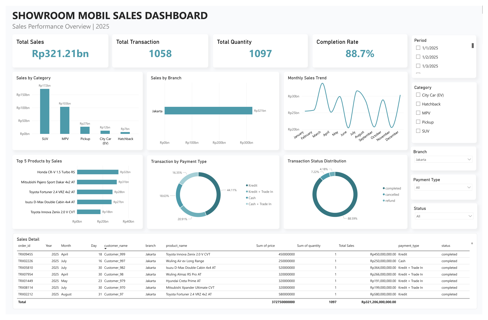

# Showroom Sales Analysis

An end-to-end data analysis portfolio project exploring sales performance across a 10-branch car showroom dataset. The project uses a cleaned dataset and a Power BI dashboard to present sales insights in an accessible, visual format.

## Project Overview

This project analyzes showroom sales data from 10 branches to help understand sales performance and support data-informed business decisions.

**Dataset:** `showroom_mobil_10cabang_clean.csv`  
**Dashboard:** Power BI (`Dashboard-Showroom.pbix`)  
**Report:** `showroom-sales-analysis-report.pdf`

## Objectives

- Explore sales performance across showroom branches.
- Present key sales metrics and trends through a Power BI dashboard.
- Communicate findings and potential business opportunities through a written report.

*Specific metrics and findings should be added here after they have been verified against the dataset and report.*

## Tools & Technologies

- **CSV** — cleaned dataset
- **Microsoft Power BI** — interactive dashboard
- **Data analysis** — sales performance exploration and reporting

## Repository Structure

```text
showroom-sales-analysis/
├── README.md
├── data/
│   └── showroom_mobil_10cabang_clean.csv
├── dashboard/
│   ├── dashboard-overview.png
│   └── Dashboard-Showroom.pbix
└── reports/
    └── showroom-sales-analysis-report.pdf
```

## Dataset

The repository includes the cleaned dataset `showroom_mobil_10cabang_clean.csv`.

For data privacy, file size, or licensing reasons, consider checking whether the dataset is appropriate to publish publicly before committing it to the repository.

## Dashboard Preview



The screenshot above provides a preview of the dashboard. To explore the interactive report, download `Dashboard-Showroom.pbix` from the `dashboard/` directory and open it in Microsoft Power BI Desktop.

## Project Report

The report is available at:

[`reports/showroom-sales-analysis-report.pdf`](https://github.com/AlphaMirror-ID/showroom-sales-analysis/blob/main/reports/showroom-sales-analysis-report.pdf)

It documents the analysis and findings from the project.

## Key Findings

_Add verified findings here, such as total sales, top-performing branches, popular car models, or sales trends. Avoid publishing figures until they have been checked against the analysis output._

## Business Recommendations

_Add recommendations based on the verified findings in the report. For example, recommendations may address branch performance, inventory planning, or sales strategy when supported by the data._

## Author

Data Analyst Portfolio Project
